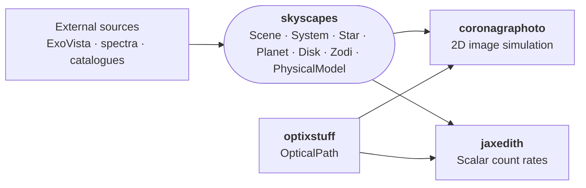

<p align="center">
  <a href="https://pypi.org/project/skyscapes/"></a>
  <a href="https://skyscapes.readthedocs.io"></a>
  <a href="https://github.com/coreyspohn/skyscapes/blob/main/LICENSE"></a>
  <a href="https://pypi.org/project/skyscapes/"></a>
</p>

# skyscapes

JAX-native astrophysical scene modeling for HWO direct imaging.

## What skyscapes is

`skyscapes` provides the **scene representation** that downstream HWO
simulation tools consume — a forward model that runs at variable
fidelity, from analytic sandbox models for fast iteration up to
research-grade physics for retrievals. High-fidelity scene generators
like [ExoVista](https://github.com/nasa/ExoVista) feed *into*
skyscapes through loaders (`from_exovista`); skyscapes does not try to
replace them.

- A `Scene` is "everything on the sky that the telescope sees" — one
  `System` (a star with planets and optionally a disk) plus optional
  background sources (zodiacal light, background galaxies, etc.).
- Source models (`Star`, `Planet`, `Disk`, physical models, backgrounds)
  are composable `eqx.Module`s — swap any one without touching the rest,
  or swap the whole class for a higher-fidelity variant.
- Loaders bridge external simulation outputs (ExoVista FITS) into the
  workspace via `from_exovista(...)`.

The same `Scene` flows through both the
[coronagraphoto](https://github.com/CoreySpohn/coronagraphoto) image
simulator and the [jaxEDITH](https://github.com/CoreySpohn/jaxedith)
ETC, so the astrophysical content is consistent across all downstream
science products.

## What skyscapes is *not*

- **Not a radiative transfer engine.** The `ExoJaxPhysicalModel` is a
  thin adapter over [ExoJAX](https://github.com/HajimeKawahara/exojax);
  skyscapes does not implement its own RT.
- **Not an orbit propagator.** Orbital mechanics live in
  [orbix](https://github.com/CoreySpohn/orbix); `Planet` composes an
  `AbstractOrbit` rather than reimplementing one.
- **Not a simulator.** Downstream tools
  ([coronagraphoto](https://github.com/CoreySpohn/coronagraphoto),
  [jaxEDITH](https://github.com/CoreySpohn/jaxedith)) consume a `Scene`
  to produce images / count rates.

## Ecosystem position



## Architecture

A `Scene` composes a `System` (star + planets + optional disk) with an
optional `Zodi` background:

- **Stars** — `Star` (wavelength- and time-dependent spectrum, ExoVista-
  backed) and `FlatStar` (constant-flux sandbox). Imported stars retain
  FITS metadata and optional `StarSpots` geometry and temperatures.
- **Planets** — `Planet` owns intrinsic params (`Rp_Rearth`,
  `Mp_Mearth`) and composes an `AbstractOrbit` (from orbix) with an
  `AbstractPhysicalModel`.
- **Physical models** — `LambertianPhysicalModel`,
  `GridPhysicalModel` (wavelength/phase contrast tables),
  `TimeSeriesPhysicalModel` (wavelength/Julian-Date contrast tables),
  `PrecomputedPhysicalModel` (cached reflectivity for hot loops), and
  `ExoJaxPhysicalModel` (full 2-stream RT via ExoJAX).
- **Disks** — `ExovistaDisk`, `ExovistaParametricDisk`, `GraterDisk`,
  `CompositeDisk`.
- **Backgrounds** — `AYOZodi` (AYO-convention defaults), `LeinertZodi`
  (full position-dependent Leinert+1998), `PrecomputedZodi` (cached
  flux array).

Every leaf is an `eqx.Module` PyTree, so JAX transforms (`jit`, `vmap`,
`grad`) compose end-to-end.

## Quick start

The easiest path is loading an ExoVista FITS file:

```python
import jax

jax.config.update("jax_enable_x64", True)

from skyscapes import Scene, from_exovista

system = from_exovista("path/to/exovista_system.fits", planet_spectra="auto")
scene = Scene(system=system)
```

The importer requires JAX x64 to preserve orbital states and epoch
precision. ExoVista's elapsed years map to Julian Dates as
`2451545.0 + 365.25 * elapsed_years`. The importer assigns simulation
time zero to J2000.0; this origin is not a measured observation date.

`from_exovista` identifies the stellar and planetary extensions from
their FITS headers, supporting both the legacy layout and the newer
layout with a starspot extension. `planet_spectra="auto"` keeps the
legacy phase-based model for older files and uses physical-time
contrast tables for newer files. Select `"time"` explicitly to retain
the sampled history in an older file, or `"phase"` to request a
phase-only approximation that discards activity history.

Imported stellar spectra use linear interpolation to preserve
nonnegative tabulated flux (`Star(interpolation_method="linear")`).
Multi-epoch stellar and time-series planet models return NaN outside
their recorded time range; a single epoch is
a static snapshot. Spectral queries remain bounded by the supplied
wavelength grid. Directly constructed `Star` objects retain cubic
interpolation by default.

`Star.spots` and `Star.metadata` preserve source records. Loading spot
geometry does not yet provide resolved stellar-surface propagation or
asymmetric stellar leakage through a coronagraph. Planet methods call
`contrast_at_time(..., time_jd=...)`; existing physical models inherit
a default hook that delegates to their phase-dependent `contrast`.

Building one from scratch:

```python
import jax.numpy as jnp
from orbix.orbit import KeplerianOrbit

from skyscapes import Scene, System
from skyscapes.scene import FlatStar, Planet
from skyscapes.physical_model import LambertianPhysicalModel
from skyscapes.background import AYOZodi

star = FlatStar(
    Ms_kg=1.989e30,
    dist_pc=10.0,
    flux_phot_per_nm_m2=1e9,
)

orbit = KeplerianOrbit(
    a_AU=jnp.array([1.0]),
    e=jnp.array([0.0]),
    W_rad=jnp.array([0.0]),
    i_rad=jnp.array([jnp.pi / 3]),
    w_rad=jnp.array([0.0]),
    M0_rad=jnp.array([0.0]),
    t0_d=jnp.array([0.0]),
)
physical_model = LambertianPhysicalModel(Ag=jnp.array([0.3]))
planet = Planet(
    Rp_Rearth=jnp.array([1.0]),
    Mp_Mearth=jnp.array([1.0]),
    orbit=orbit,
    physical_model=physical_model,
)

zodi = AYOZodi(
    wavelengths_nm=jnp.linspace(400, 1000, 60),
    surface_brightness_mag=22.0,
)

scene = Scene(
    system=System(star=star, planets=(planet,)),
    zodi=zodi,
)
```

## Installation

```bash
pip install skyscapes
```

## Status

This package is in early development.
