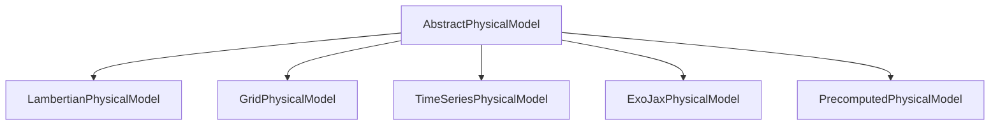

# Physical models

`skyscapes.physical_model` provides the **planet-to-star contrast**
model attached to every `Planet`. A physical model returns, given a
phase angle, star-planet distance, wavelength, planet radius, and when
needed the physical observation time, the
dimensionless contrast $f_p / f_*$ that scales the host star's
spectrum into the planet's emitted flux. The submodule covers
atmospheric reflection, surface reflection, thermal emission, and
joint planet + atmosphere models.

## The hierarchy



`Planet.contrast` and `Planet.alpha_dMag` call
`physical_model.contrast_at_time(phase_angle_rad, dist_AU,
wavelength_nm, Rp_Rearth, time_jd=...)`. This returns per-planet
flux-ratio contrast, shape `(K, T)` for `K` planets and `T` epochs.
The default `AbstractPhysicalModel.contrast_at_time` ignores the time
argument and forwards the other arguments to `contrast`, so existing
phase-dependent models retain their behavior. Time-dependent models
override the hook to use the physical epochs directly.

Each physical model carries per-planet state as JAX arrays of length
`K`. Planet radius is passed in at call time from the host `Planet`;
the model does not store it. Heterogeneous planets
(different physical-model classes) compose into a `System.planets`
tuple, with one `Planet` per physical-model type.

## Variants and when to use them

### `LambertianPhysicalModel`

Lambert phase function with constant geometric albedo. No wavelength
dependence; analytic and fast.

```python
import jax.numpy as jnp
from skyscapes.physical_model import LambertianPhysicalModel

model = LambertianPhysicalModel(Ag=jnp.array([0.3]))
```

**Use for**: first-pass forward modeling, sandbox / debugging,
closed-form sanity checks. Most-used variant in early-stage work.

### `GridPhysicalModel`

Wraps an externally computed contrast cube as a 2-D `interpax` spline
over `(wavelength, phase_angle)` per planet. Differentiable through
the interpolation. `from_exovista` uses this model for legacy files
under `planet_spectra="auto"`, or for any supported layout when
`planet_spectra="phase"` is explicitly selected.

```python
import jax.numpy as jnp
from skyscapes.physical_model import GridPhysicalModel

model = GridPhysicalModel(
    wavelengths_nm=jnp.linspace(400, 1000, 60),     # (n_wl,)
    phase_angle_deg=jnp.linspace(0, 180, 19),       # (n_phase,)
    contrast_grid=...,                              # (K, n_wl, n_phase)
)
```

**Use for**: tabulated atmospheres from grid-based RT codes;
phase-only ExoVista approximations; comparison studies; when you have a
`(wl, phase) -> contrast` LUT and want it integrated with the rest of
the pipeline.

### `TimeSeriesPhysicalModel`

Preserves an externally computed contrast history on a
`(wavelength, Julian Date)` grid for each planet. Linear interpolation
uses the recorded physical times, including unevenly spaced epochs.
Two epochs with the same orbital phase can retain different contrasts.
Phase angle, distance, and radius are accepted for interface
compatibility but are ignored: their effects are already encoded in
the tabulated planet-to-star flux ratios.

```python
import jax

jax.config.update("jax_enable_x64", True)

import jax.numpy as jnp
from skyscapes.physical_model import TimeSeriesPhysicalModel

model = TimeSeriesPhysicalModel(
    wavelengths_nm=jnp.array([500.0, 600.0]),
    times_jd=jnp.array([2451545.0, 2451546.0]),
    contrast_grid=jnp.array([[[1e-10, 2e-10], [3e-10, 4e-10]]]),
    # contrast_grid shape: (K=1, W=2, T=2)
)
contrast = model.contrast_at_time(
    phase_angle_rad=jnp.array([[0.4, 0.4]]),
    dist_AU=jnp.ones((1, 2)),
    wavelength_nm=550.0,
    Rp_Rearth=jnp.ones(1),
    time_jd=jnp.array([2451545.0, 2451546.0]),
)
# contrast: [[2e-10, 3e-10]], despite the identical phase angles
```

Both grids must be finite, nonempty, and strictly increasing. The
contrast cube must have shape `(K, W, T)` and contain finite,
nonnegative values. Linear interpolation preserves nonnegativity
within the table. Float32 contrast storage is retained; query
arithmetic promotes the inputs to a common dtype. Use float64 Julian
Dates to retain subday resolution.

With multiple epochs, queries outside the recorded time range return
NaN. A single epoch represents a static snapshot and is valid at any
finite time. Wavelength support is always bounded; a single
wavelength is valid only at that wavelength. Calling `contrast`
without time raises `ValueError` and directs the caller to
`contrast_at_time`.

**Use for**: recorded variability or other contrast histories that are
not single-valued functions of orbital phase. `from_exovista` selects
this model automatically for the newer FITS layout with a starspot
extension, including v2.6, and supports `planet_spectra="time"` for
older files. This retains the supplied history without inventing
evolution beyond its time range. The `"phase"` option remains an
explicit phase-only approximation.

### `ExoJaxPhysicalModel`

Full ExoJax 2-stream radiative transfer. Computes reflectivity from
first principles given molecular mass mixing ratios (H2O, CO2, CH4,
O2, O3, ...). The full constructor exposes a lot of knobs; the
ergonomic entry point is `ExoJaxPhysicalModel.from_default_setup`:

```python
import jax.numpy as jnp
from skyscapes.physical_model import ExoJaxPhysicalModel

model = ExoJaxPhysicalModel.from_default_setup(
    log_mmrs={"H2O": jnp.array([-4.0]), "CO2": jnp.array([-3.5])},
    T_eq_K=jnp.array([288.0]),
    T_alpha=jnp.array([0.0]),
    log_surface_albedo=jnp.array([-1.0]),
    log_gravity_cgs=jnp.array([2.99]),
    wavelength_min_nm=400.0,
    wavelength_max_nm=1000.0,
)
```

**Use for**: research-grade physics; retrievals on real atmospheric
composition; joint atmosphere + orbit fitting workflows.

The first call triggers a HITRAN download and a 1-3 minute setup
(see `PrecomputedPhysicalModel` below to avoid this cost in inner
loops).

### `PrecomputedPhysicalModel`

Wraps an ExoJax model's full per-planet reflectivity grid as a fast
lookup. Once you've built the underlying `ExoJaxPhysicalModel`,
freeze it for inner-loop reuse:

```python
from skyscapes.physical_model import ExoJaxPhysicalModel, PrecomputedPhysicalModel

# One-shot RT computation
ej = ExoJaxPhysicalModel.from_default_setup(...)
cached = PrecomputedPhysicalModel.from_physical_model(ej)

# Use as a drop-in physical model
contrast = cached.contrast(
    phase_angle_rad=jnp.array([[jnp.pi / 3]]),   # (K, T)
    dist_AU=jnp.array([[1.0]]),                  # (K, T)
    wavelength_nm=550.0,
    Rp_Rearth=jnp.array([1.0]),                  # (K,)
)
```

`from_physical_model` currently supports `ExoJaxPhysicalModel` (the
classmethod calls the model's internal `_reflectivity_all_planets`).
The cache can also be persisted to disk via `.save(path)` and reloaded
via `PrecomputedPhysicalModel.load(path)`.

**Use for**: any time you need the same physical model in a hot inner
loop (forward simulation, MCMC sampling, multi-target evaluation).

## Composition with `Planet`

A `Planet` carries its intrinsic params (`Rp_Rearth`, `Mp_Mearth`)
plus an orbit and a physical model:

```python
import jax.numpy as jnp
from orbix.orbit import KeplerianOrbit
from skyscapes.scene import Planet
from skyscapes.physical_model import LambertianPhysicalModel

orbit = KeplerianOrbit(
    a_AU=jnp.array([1.0]),
    e=jnp.array([0.0]),
    W_rad=jnp.array([0.0]),
    i_rad=jnp.array([jnp.pi / 3]),
    w_rad=jnp.array([0.0]),
    M0_rad=jnp.array([0.0]),
    t0_d=jnp.array([0.0]),
)
physical_model = LambertianPhysicalModel(Ag=jnp.array([0.3]))
planet = Planet(
    Rp_Rearth=jnp.array([1.0]),
    Mp_Mearth=jnp.array([1.0]),
    orbit=orbit,
    physical_model=physical_model,
)
```

Heterogeneous physical models compose at the `System.planets` level
-- one `Planet` per model type, each batching its own `K` planets:

```python
lambertian_planet = Planet(
    Rp_Rearth=..., Mp_Mearth=...,
    orbit=lambertian_orbit,
    physical_model=LambertianPhysicalModel(...),
)
cached_planet = Planet(
    Rp_Rearth=..., Mp_Mearth=...,
    orbit=cached_orbit,
    physical_model=PrecomputedPhysicalModel.from_physical_model(...),
)
system = System(star=star, planets=(lambertian_planet, cached_planet))
```

## Performance budget

Approximate cost per planet per wavelength on GPU:

| Physical model | Per-call cost |
|---|---|
| `LambertianPhysicalModel` | ~0.01 ms |
| `GridPhysicalModel` | ~0.05 ms (interp lookup) |
| `PrecomputedPhysicalModel` | ~0.15 ms (1-D interp) |
| `ExoJaxPhysicalModel` | ~13 ms (full 2-stream RT) |

`PrecomputedPhysicalModel` is the right tool for inner loops where you
need ExoJax-quality physics but cannot afford 13 ms per evaluation.
Pre-compute once at simulation setup, then use the cached version for
all subsequent calls.

## Wavelength dependence

Use a scalar wavelength per call for the common `(K, T)` interface.
For an IFS-style spectral cube, map over wavelengths to obtain shape
`(W, K, T)`. The time-aware hook works with both phase-dependent and
time-series models:

```python
import jax
import jax.numpy as jnp

wavelengths = jnp.linspace(500, 600, 100)
times_jd = jnp.array([2451545.0])
phase = jnp.array([[jnp.pi / 3]])    # (K=1, T=1)
dist  = jnp.array([[1.0]])           # (K=1, T=1)
Rp    = jnp.array([1.0])             # (K=1,)

contrast_spectrum = jax.vmap(
    lambda wl: model.contrast_at_time(phase, dist, wl, Rp, time_jd=times_jd),
)(wavelengths)
```

For `ExoJaxPhysicalModel` specifically, the RT routine is vectorised
internally, so `contrast_cube` runs at ~13 ms regardless of wavelength
count (up to ~100 wl bins).

## See also

- [Source models](source_models) -- `Planet` and the rest of the
  scene hierarchy
