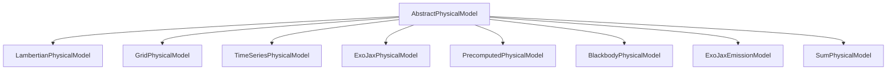

# Physical models

`skyscapes.physical_model` provides the **planet photon flux and contrast**
model attached to every `Planet`. Given geometry, wavelength, radius,
observation time and the host star, a physical model returns observer flux
in ph/s/m²/nm or the dimensionless planet-to-star ratio $f_p / f_*$.
The submodule covers atmospheric reflection, surface reflection, thermal
emission, and sums of these contributions.

## The hierarchy



`Scene.planet_flux_densities` calls
`physical_model.photon_flux_density(wavelength_nm, phase_angle_rad=...,
star_planet_distance_AU=..., Rp_Rearth=..., time_d=..., star=..., dist_pc=...)`. This scene
reader supplies a scalar wavelength and returns `(K, T)` in ph/s/m²/nm.
The physical-model method accepts arbitrary wavelength shapes. The base implementation
multiplies `contrast_at_time` by stellar photon flux. Thermal models
compute observer flux directly, then derive contrast by dividing by the
star's flux. Blackbody contrast against a `BlackbodyStar` retains the
equivalent analytic ratio to avoid losing numerical range. Thermal flux
needs the observer distance but does not require a nonzero or defined
stellar spectrum; a contrast ratio still needs a valid denominator.
Consumers integrate photon densities with `optixstuff.spectral.Quadrature`;
source methods accept wavelength arrays and have no band or bin-width input.
The model photon result has shape `(K, T) + wavelength_nm.shape`.

`Scene.contrasts` and `Scene.alpha_dMag` call
`physical_model.contrast_at_time(phase_angle_rad, star_planet_distance_AU,
wavelength_nm, Rp_Rearth, time_d=..., star=..., dist_pc=...)`. This returns per-planet
flux-ratio contrast, shape `(K, T)` for `K` planets and `T` epochs.
The default `AbstractPhysicalModel.contrast_at_time` ignores the time
argument and forwards the other arguments to `contrast`, so existing
phase-dependent models retain their behavior. Time-dependent models
override the hook to use the physical epochs directly.

Each physical model carries per-planet state as JAX arrays of length
`K`. Planet radius is passed in at call time from the host `Planet`;
the model does not store it. Heterogeneous planets
(different physical-model classes) compose into a `Scene.planets`
tuple, with one `Planet` per physical-model type.

## Variants and when to use them

### `SumPhysicalModel`

Add two or more radiative contributions for the same planet, sharing its
radius, orbit geometry and host star. Components are a nonempty tuple;
their parameters remain differentiable JAX leaves.

```python
import jax.numpy as jnp
from skyscapes.physical_model import (
    BlackbodyPhysicalModel,
    LambertianPhysicalModel,
    SumPhysicalModel,
)

model = SumPhysicalModel(
    (
        LambertianPhysicalModel(Ag=jnp.array([0.3])),
        BlackbodyPhysicalModel(teff_K=jnp.array([288.0])),
    )
)
```

Its photon flux is the component sum, and `contrast_at_time` divides that
sum by stellar flux. An empty tuple raises `ValueError`. The phase-only
`contrast` call requires callers to use the time-aware method with a star.

### `BlackbodyPhysicalModel` and `ExoJaxEmissionModel`

`BlackbodyPhysicalModel` emits a uniform Planck disk at `teff_K`.
`ExoJaxEmissionModel` computes atmospheric thermal emission; see the
[thermal-emission how-to](../how-to/thermal_emission.md). Both implement
the common flux interface without normalizing by the star first.

The blackbody uses the common `photon_flux_density` interface with geometry
and stellar context. ExoJAX's `flux_density_jy`
continues to return `(W, K)` in Jy.

### `LambertianPhysicalModel`

Lambert phase function with constant geometric albedo. No wavelength
dependence; analytic and fast.

```python
import jax.numpy as jnp
from skyscapes.physical_model import LambertianPhysicalModel

model = LambertianPhysicalModel(Ag=jnp.array([0.3]))
```

**Use for**: first-pass forward modeling, sandbox / debugging,
closed-form sanity checks. Most-used variant in early-stage work.

### `GridPhysicalModel`

Wraps an externally computed contrast cube as a 2-D `interpax` spline
over `(wavelength, phase_angle)` per planet. Differentiable through
the interpolation. `from_exovista` uses this model for legacy files
under `planet_spectra="auto"`, or for any supported layout when
`planet_spectra="phase"` is explicitly selected.

Requires a user-supplied contrast grid.

```python notest
import jax.numpy as jnp
import numpy as np
from skyscapes.physical_model import GridPhysicalModel

model = GridPhysicalModel(
    knots=np.linspace(400, 1000, 60),  # (n_wl,), static host knots
    phase_angle_deg=jnp.linspace(0, 180, 19),  # (n_phase,)
    contrast_grid=...,  # (K, n_wl, n_phase)
)
```

**Use for**: tabulated atmospheres from grid-based RT codes;
phase-only ExoVista approximations; comparison studies; when you have a
`(wl, phase) -> contrast` LUT and want it integrated with the rest of
the pipeline.

### `TimeSeriesPhysicalModel`

Preserves an externally computed contrast history on a
`(wavelength, days from the scene epoch)` grid for each planet. Linear interpolation
uses the recorded physical times, including unevenly spaced epochs.
Two epochs with the same orbital phase can retain different contrasts.
Phase angle, distance, and radius are accepted for interface
compatibility but are ignored: their effects are already encoded in
the tabulated planet-to-star flux ratios.
Its `photon_flux_density` therefore multiplies the interpolated contrast
by the host star's flux at each epoch, retaining the table's semantics.

```python
import jax

jax.config.update("jax_enable_x64", True)

import jax.numpy as jnp
from skyscapes.physical_model import TimeSeriesPhysicalModel

model = TimeSeriesPhysicalModel(
    wavelengths_nm=jnp.array([500.0, 600.0]),
    times_d=jnp.array([0.0, 1.0]),
    contrast_grid=jnp.array([[[1e-10, 2e-10], [3e-10, 4e-10]]]),
    # contrast_grid shape: (K=1, W=2, T=2)
)
contrast = model.contrast_at_time(
    phase_angle_rad=jnp.array([[0.4, 0.4]]),
    star_planet_distance_AU=jnp.ones((1, 2)),
    wavelength_nm=550.0,
    Rp_Rearth=jnp.ones(1),
    time_d=jnp.array([0.0, 1.0]),
)
# contrast: [[2e-10, 3e-10]], despite the identical phase angles
```

Both grids must be finite, nonempty, and strictly increasing. The
contrast cube must have shape `(K, W, T)` and contain finite,
nonnegative values. Linear interpolation preserves nonnegativity
within the table. Float32 contrast storage is retained; query
arithmetic promotes the inputs to a common dtype. Both `times_d` and
query `time_d` are days from the owning scene epoch. Convert absolute
dates on the host with `system.epoch.days(jd=...)` before transfer to JAX.

With multiple epochs, queries outside the recorded time range return
NaN. A single epoch represents a static snapshot and is valid at any
finite time. Wavelength support is always bounded; a single
wavelength is valid only at that wavelength. Calling `contrast`
without time raises `ValueError` and directs the caller to
`contrast_at_time`.

**Use for**: recorded variability or other contrast histories that are
not single-valued functions of orbital phase. `from_exovista` selects
this model automatically for the newer FITS layout with a starspot
extension, including v2.6, and supports `planet_spectra="time"` for
older files. This retains the supplied history without inventing
evolution beyond its time range. The `"phase"` option remains an
explicit phase-only approximation.

### `ExoJaxPhysicalModel`

Full ExoJax 2-stream radiative transfer. Computes reflectivity from
first principles given molecular mass mixing ratios (H2O, CO2, CH4,
O2, O3, ...). The full constructor exposes a lot of knobs; the
ergonomic entry point is `ExoJaxPhysicalModel.from_default_setup`:

Building HITRAN line-opacity engines requires float64 and locally configured
line lists. A model using only tabulated cross sections supports either
precision.

```python notest
import jax.numpy as jnp
from hwoutils.precision import enable_x64
from skyscapes.physical_model import ExoJaxPhysicalModel

enable_x64()

model = ExoJaxPhysicalModel.from_default_setup(
    log_mmrs={"H2O": jnp.array([-4.0]), "CO2": jnp.array([-3.5])},
    T_eq_K=jnp.array([288.0]),
    T_alpha=jnp.array([0.0]),
    log_surface_albedo=jnp.array([-1.0]),
    log_gravity_cgs=jnp.array([2.99]),
    low_nm=400.0,
    high_nm=1000.0,
)
```

**Use for**: research-grade physics; retrievals on real atmospheric
composition; joint atmosphere + orbit fitting workflows.

The first call triggers a HITRAN download and a 1-3 minute setup
(see `PrecomputedPhysicalModel` below to avoid this cost in inner
loops).

#### Spectral grid resolution

The opacity grid must resolve molecular lines before the emergent spectrum is
binned to an instrument resolution. A coarse grid overstates the depths of
line-resolved bands such as the O2 A-band and H2O, even when the final spectrum
is binned to R=140. Use sampling resolving power $R_{\rm grid} \gtrsim 10^5$.
This is distinct from the instrument resolving power.

ExoJAX models and their precomputed reflectivity caches declare their native
wavelength grid through `spectral_breaks_nm()`, so a band integral places
quadrature nodes between every pair of grid points and resolves line cores.
Four Gauss nodes across the O2 A-band instead of the native grid move the band
mean by about 4%. Integration cost therefore scales with the grid size.

The default is `resolving_power=1.5e5`. For the logarithmic wavenumber grid,
$R_{\rm grid} = N / \ln(\nu_{\max}/\nu_{\min})$, using the point-count convention.
Thus `N = ceil(resolving_power * ln(nu_max / nu_min))`, rounded up to even
because ExoJAX premodit requires an even point count. The logarithmic sampling
follows [Kawahara et al. (2022), ApJS 258, 31, Section 2.1.2](https://arxiv.org/abs/2105.14782);
see also the [ExoJAX grid documentation](https://secondearths.sakura.ne.jp/exojax/exojax/exojax.utils.html#exojax.utils.grids.wavenumber_grid).
Over 400-1000 nm the default uses 137444 points; a 2000-point grid would
give only $R_{\rm grid} \simeq 2200$.

Measured Earth-modern R=140-binned minimum/continuum ratios illustrate the
sampling error (smaller ratios mean deeper absorption):

| Band | Grid resolving power | Minimum/continuum |
|---|---:|---:|
| O2 A-band | 1700 | 0.030 |
| O2 A-band | 8700 | 0.280 |
| O2 A-band | 26000 | 0.520 |
| O2 A-band | 75000 | 0.555 |
| O2 A-band | 150000 | 0.573 |
| O2 A-band | 300000 | 0.572 |
| H2O, 0.94 um | 95000 | 0.600 |
| H2O, 0.94 um | 190000 | 0.625 |
| H2O, 0.94 um | 380000 | 0.633 |

These measurements motivate the default; convergence still depends on the
band and atmosphere. The cached-data regression test in
`tests/test_physical_model_exojax.py` compares the default and 300000 sampling
over 750-780 nm with identical R=140 bins and atmosphere at both samplings.

Memory and opacity evaluation time grow with `n_layers * n_wavenumbers` per
absorbing species; premodit also stores line-density tables. Prefer a narrow
wavelength window, for example `low_nm=750, high_nm=780`,
to retain line accuracy at lower cost. To choose speed explicitly, pass
`n_wavenumbers=2000`; an explicit count overrides `resolving_power` and is
rounded up to even. Line-list models emit a `UserWarning` below
$R_{\rm grid}=10^5$, including when an explicit point count is supplied.
PSG-only cross-section models do not emit this band-depth warning. Both
`from_default_setup` and `from_default_setup_cached` accept these grid options;
the cached factory includes resolving power in its cache key.

Reflected outputs, including precomputed models, use linear interpolation to
preserve nonnegative values inside the grid. Linear extrapolation remains
enabled outside the modeled wavelength range and can produce negative values;
evaluate within the configured range for physical band predictions.

### `PrecomputedPhysicalModel`

Wraps an ExoJax model's full per-planet reflectivity grid as a fast
lookup. Once you've built the underlying `ExoJaxPhysicalModel`,
freeze it for inner-loop reuse:

Requires a configured radiative-transfer model and its opacity data.

```python notest
from skyscapes.physical_model import ExoJaxPhysicalModel, PrecomputedPhysicalModel

# One-shot RT computation
ej = ExoJaxPhysicalModel.from_default_setup(...)
cached = PrecomputedPhysicalModel.from_physical_model(ej)

# Use as a drop-in physical model
contrast = cached.contrast(
    phase_angle_rad=jnp.array([[jnp.pi / 3]]),  # (K, T)
    star_planet_distance_AU=jnp.array([[1.0]]),  # (K, T)
    wavelength_nm=550.0,
    Rp_Rearth=jnp.array([1.0]),  # (K,)
)
```

`from_physical_model` currently supports `ExoJaxPhysicalModel` (the
classmethod calls the model's public `reflectivity()`).
The cache can also be persisted to disk via `.save(path)` and reloaded
via `PrecomputedPhysicalModel.load(path)`.

**Use for**: any time you need the same physical model in a hot inner
loop (forward simulation, MCMC sampling, multi-target evaluation).

## Composition with `Planet`

A `Planet` carries its radii (`Rp_Rearth`) and a physical model.
The shared `Scene.dynamics` owns masses and orbital state:

```python
import jax.numpy as jnp
from skyscapes.scene import Planet
from skyscapes.physical_model import LambertianPhysicalModel

physical_model = LambertianPhysicalModel(Ag=jnp.array([0.3]))
planet = Planet(
    Rp_Rearth=jnp.array([1.0]),
    physical_model=physical_model,
)
```

Heterogeneous physical models compose at the `Scene.planets` level
-- one `Planet` per model type, each batching its own `K` planets:

Requires a user-supplied `orbix.system.System` named `dynamics`,
stellar data, and physical models.

```python notest
from skyscapes import Scene
from skyscapes.physical_model import PrecomputedPhysicalModel

lambertian_planet = Planet(
    Rp_Rearth=...,
    physical_model=LambertianPhysicalModel(...),
)
cached_planet = Planet(
    Rp_Rearth=...,
    physical_model=PrecomputedPhysicalModel.from_physical_model(...),
)
system = Scene(
    star=star,
    planets=(lambertian_planet, cached_planet),
    dynamics=dynamics,
)
```

## Performance budget

Approximate cost per planet per wavelength on GPU:

These illustrative timings depend on the spectral grid and hardware; they
are not benchmarks for the default ExoJAX sampling at `resolving_power=1.5e5`.

| Physical model | Per-call cost |
|---|---|
| `LambertianPhysicalModel` | ~0.01 ms |
| `GridPhysicalModel` | ~0.05 ms (interp lookup) |
| `PrecomputedPhysicalModel` | ~0.15 ms (1-D interp) |
| `ExoJaxPhysicalModel` | ~13 ms (full 2-stream RT) |

`PrecomputedPhysicalModel` is the right tool for inner loops where you
need ExoJax-quality physics without repeated radiative transfer.
Pre-compute once at simulation setup, then use the cached version for
all subsequent calls.

## Wavelength dependence

Use a scalar wavelength per call for the common `(K, T)` interface.
For an IFS-style spectral cube, map over wavelengths to obtain shape
`(W, K, T)`. The time-aware hook works with both phase-dependent and
time-series models:

Requires a configured physical model with the desired wavelength coverage.

```python notest
import jax
import jax.numpy as jnp

wavelengths = jnp.linspace(500, 600, 100)
times_d = jnp.array([0.0])
phase = jnp.array([[jnp.pi / 3]])  # (K=1, T=1)
dist = jnp.array([[1.0]])  # (K=1, T=1)
Rp = jnp.array([1.0])  # (K=1,)

contrast_spectrum = jax.vmap(
    lambda wl: model.contrast_at_time(phase, dist, wl, Rp, time_d=times_d),
)(wavelengths)
```

For `ExoJaxPhysicalModel` specifically, `contrast_cube` shares one RT
calculation across all requested wavelengths per planet. Its cost depends
primarily on the opacity grid width, resolving power, layers, and species;
the requested output wavelengths then add interpolation cost.

## See also

- [Source models](source_models) -- `Planet` and the rest of the
  scene hierarchy
