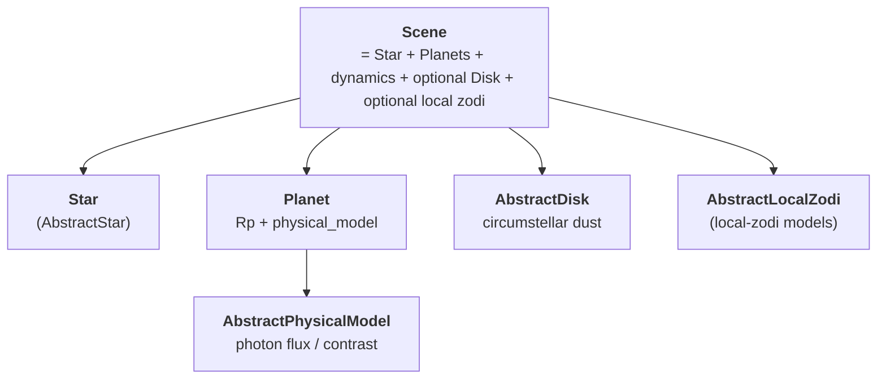

# Source models

skyscapes represents an astrophysical scene as a tree of `eqx.Module`
sources. This page covers what each source type is, how they compose,
and which variant to reach for in a given situation.

`Scene.ephemeris` returns orbix's barycentric (east, north, away)
states, with scene-order planet indices for relative observables. This
frame is right-handed: z is positive away from the observer, and dz/dt is positive receding. The standard phase angle
beta satisfies `cos(beta) = z / r` for the star-relative vector
(zero at full phase).
`Scene.positions` returns rows 0 and 1 as (Delta alpha*, Delta Dec), where
Delta alpha* = Delta RA cos Dec. ExoVista positions and velocities are
converted from (west, north, toward) with `(-x, y, -z)` before deriving
elements; the header midplane maps to astronomical `(90 + PA) % 360`.

## The hierarchy



A complete `Scene` is:

Interface sketch; the concrete classes are defined in the package.

```python notest
class Scene(eqx.Module):
    star: AbstractStar
    planets: tuple[Planet, ...]
    dynamics: orbix.system.System
    disk: AbstractDisk | None = None  # the only exozodi
    local_zodi: AbstractLocalZodi | None = None
    midplane_inc_deg: float = 0.0
    midplane_position_angle_deg: float = 0.0
    ...
```

The sky position is not a star property: `scene.ra_deg` and `scene.dec_deg` read the
`dynamics.frame` (ICRS degrees, set with `Scene.from_classical(..., ra_deg=, dec_deg=)`),
and are `None` for an unplaced scene.

Every level is an `eqx.Module`, which means: PyTree-registered for
JAX, fields are checked at construction, and `eqx.tree_at` works
end-to-end.

## Stars

Three concrete `AbstractStar` implementations:

| Class | When to use |
|---|---|
| `Star` | Tabulated stellar spectral flux, interpolated over wavelength and time with `interpax`. A single epoch is a static spectrum. ExoVista-loaded systems use this. |
| `FlatStar` | Simplification: constant flux independent of wavelength or time. Sandbox / testing / closed-form sanity checks. |
| `BlackbodyStar` | Planck blackbody spectrum from effective temperature, stellar radius, and distance. Static physical approximation for converting planet contrast to flux. |

Requires user-supplied stellar flux-density measurements.

```python notest
import jax

jax.config.update("jax_enable_x64", True)

from skyscapes.scene import Star, FlatStar, BlackbodyStar
import jax.numpy as jnp

# Realistic: wavelength + time dependence; days from the scene epoch
star = Star(
    wavelengths_nm=jnp.linspace(400, 1000, 60),
    times_d=jnp.array([0.0, 730.5]),
    flux_density_jy=...,  # shape (n_wl, n_time)
)

# Sandbox: constant flux
flat = FlatStar(
    flux_phot_per_nm_m2=1e9,
)

# Physical approximation: a solar-temperature blackbody at 10 pc
blackbody = BlackbodyStar(
    teff_K=5772.0,
    radius_m=6.957e8,
)

# All implement the same interface
print(star.photon_flux_density(wavelength_nm=550.0, time_d=365.0, dist_pc=10.0))
print(flat.photon_flux_density(wavelength_nm=550.0, time_d=365.0, dist_pc=10.0))
print(
    blackbody.photon_flux_density(
        wavelength_nm=550.0,
        time_d=365.0,
        dist_pc=10.0,
    )
)
```

`Star` is the canonical choice for any real target -- it ingests
ExoVista-style time- and wavelength-dependent flux tables. `FlatStar`
is the sandbox stand-in when you only need a single constant flux
value.

`BlackbodyStar` evaluates the Planck function in photon units and returns
the observer flux in photons/s/m^2/nm. Following Rybicki and Lightman
(1979), *Radiative Processes in Astrophysics*, the surface flux is
`pi * B_photon`, diluted by `(radius_m / (dist_pc * pc2m))**2` at the
observer. All stars expose `angular_diameter_arcsec(dist_pc)`, and
`photon_flux_density` multiplies the private `_photon_flux_density` hook by
`flux_scale` (see [Source brightness](#source-brightness-flux-scale)). Apparent-flux
`Star` and `FlatStar` ignore the supplied distance and return their
`fixed_diameter_arcsec` value. Wavelengths are in nanometers,
and the result retains their shape. The spectrum is static, so `time_d` is ignored. Both `jax.jit`
and `jax.vmap` over wavelength are supported.

`flux_density_jy` is the observer's disk-integrated spectral flux
density, shape `(n_wl, n_time)`. `Star` converts this table once to photon
density at construction. `photon_flux_density` interpolates that photon table
and returns photons/s/m^2/nm.
`spectral_breaks_nm()` exposes table breakpoints for every interpolation method.
A Gauss-Legendre rule split at the knots integrates a linear photon table
exactly, even at order one. A rule that is not split at the knots integrates
the table exactly through `Scene.sources` instead (see
[Band integrals of tabulated spectra](#band-integrals-of-tabulated-spectra)). Direct construction uses cubic interpolation by
default; stars imported with `from_exovista` use linear interpolation
(`interpolation_method="linear"`) to avoid overshooting nonnegative
samples. Multi-epoch tables return NaN outside their time range.
A single-epoch table is static at any
time, while the wavelength range remains bounded.
`Star.wavelengths_nm` exposes the tabulated wavelength grid in nm without
copying it. `Star.wavelength_range_nm` returns its minimum and maximum
as a tuple of Python floats. Both properties are read-only.

### Imported starspots and metadata

`Star.spots` is either `None` or a `StarSpots` object imported from the
optional ExoVista spot extension. It stores `times_d` and geometry
arrays with shape `(n_times, n_spots)`:

| Field | Meaning |
|---|---|
| `latitude_deg`, `longitude_deg` | Recorded positions in the source's stellar coordinate convention |
| `area_m2` | Total spot area, including the umbra, converted from the FITS area units |
| `area_ratio` | Total spot area divided by umbra area |
| `umbra_temperature_K`, `penumbra_temperature_K` | Component temperatures from the stellar header, or `None` when absent |

`Star.metadata` retains the stellar FITS header values under uppercase
keys, excluding blank, `COMMENT`, and `HISTORY` cards. These records
preserve the source information, including the original west-based `PA`.
The system's disk orientation instead uses `Scene.midplane_inc_deg = I`
and `Scene.midplane_position_angle_deg = (90 + PA) % 360` in the east/north chart, for
parametric disks and visualization outlines. The metadata do not supply
spot evolution or an evaluator for spatially resolved stellar intensity. A downstream
diameter-only coronagraph response does not acquire asymmetric
starspot leakage merely by loading `Star.spots`. That calculation
requires a surface-brightness model and an optical response evaluated
across the stellar disk.

### ExoVista layouts and time conventions

Enable `jax_enable_x64` before calling `from_exovista`; the importer
requires it to preserve orbital-state precision and raises
`ValueError` when x64 is disabled. ExoVista stores elapsed simulation
years. The importer assigns simulation time zero to J2000.0 and
converts Julian years using
`absolute_dates = 2451545.0 + 365.25 * elapsed_years`. This assigned origin is
not a measured observation date, and the year values are not calendar
decimal years. The first stellar timestamp sets `system.epoch`, split
into whole and fractional days on the host. The file states no time scale;
the default `tdb` label applies without conversion. Stored stellar, spot,
planet-table, and orbit reference times are days from this scene epoch,
converted in NumPy float64 before transfer to JAX.

The importer locates the star and planets using their FITS headers.
It supports the legacy stellar extension and the newer layout with a
spot extension before the star, including ExoVista v2.6, without
relying on an extension-count header alone.

### Orbital dynamics of loaded planets

ExoVista writes barycentric states for the star and each planet. The
importer converts them to the (east, north, away) chart and builds the
shared `Scene.dynamics` Jacobi chain. Dynamics owns the stellar and
planetary masses and the observer distance; these are available through
`Scene.star_mass_Msun`, `Scene.planet_mass_Msun`, and `Scene.dist_pc`.
`Scene.ephemeris(time_d)` propagates the shared system with Markley by
default. Its barycentric states support star-relative planet geometry,
stellar reflex motion, and radial velocity without separate orbit solves.

Subtracting the star's barycentric motion also changes what phase-mode
planets look like. With `planet_spectra="phase"` the contrast is a function
of the star-planet-observer angle $\beta$ and the star-planet distance, both
computed from the star-relative orbit. In the eight-planet solar-system
demo scene the star sits 0.0077 AU from the barycenter, which is 0.55 to
1.07 percent of the inner planets' orbital radii. Loading it with
star-relative states instead of barycentric ones changes the phase-mode
planet contrasts at 600 nm over the 367 FITS epochs by a median of 0.4 to
4.4 percent for the six inner planets, by up to 30 percent at their 99th
percentile (the innermost planet; 21 percent for the third, 13 percent for
the fourth and 7 percent for the fifth) and up to 31 percent at the single
worst epoch of the innermost planet, where the contrast curve is steepest. The two
outer planets change by about 2e-5 relative. The size is set by the ratio of
the star's offset to the planet's orbital radius, so it grows toward small
orbits. The peak depends strongly on which epochs and planets are sampled,
so the distribution is given. The numbers come from loading the same file twice, once as written and once with
the star's rows zeroed so that the barycentric states are used as relative
states, and taking the relative difference of `Scene.contrasts`.
`tools/star_reflex_contrast.py` reproduces them and prints the median,
99th-percentile and maximum change for each planet; run
`python tools/star_reflex_contrast.py [wavelength_nm]` from the repository
root. Time-mode contrasts are unchanged because they are read from the FITS
table directly.

The stellar angular diameter is $2 R_\star / d$, computed from the
header's `RSTAR` (solar radii) and `DIST` (pc). ExoVista's `ANGDIAM`
card is not used for it, because its meaning depends on the input: a
scene built from a system file stores the angular radius there, while a
scene built from the target catalog stores the angular diameter and
derives `RSTAR` from it. Every ExoVista version this importer reads
records `RSTAR` and `DIST`; a stellar header without a finite `RSTAR` of at least zero and a
finite positive `DIST` is rejected rather than read from `ANGDIAM` at a
possibly halved size.

ExoVista documents the stellar spectral columns as observer flux
density in Jy, but the v2.5 and v2.6 writers store the PHOENIX emergent
surface flux density $F_\lambda$ in erg s$^{-1}$ cm$^{-2}$ cm$^{-1}$,
multiplied by the area of their limb-darkening mask (0.91091 of the
geometric disk for the solar coefficients they hard-code). A stellar
extension marked `SPECUNIT='Jy'` is read as Jy. A newer-layout file
without the marker is converted to the observer flux density

$$F_\nu = \frac{F_\lambda^{\rm stored}}{0.91091}
\left(\frac{R_\star}{d}\right)^2 \frac{\lambda^2}{c},$$

using the header's `RSTAR` and `DIST`, with no factor of $\pi$ because
PHOENIX tabulates flux rather than intensity. Both must be finite numbers,
or the import fails. When the header carries a numeric `VMAG` and a
channel lies within 60 nm of 550 nm, the converted spectrum there must lie
within a factor of three of that magnitude's flux, or the import fails
rather than guess the units. Without either, the spectrum is converted
with a warning that it could not be checked. Legacy-layout files are read
as Jy, and an explicitly different `SPECUNIT` is rejected.

The `planet_spectra` argument determines the planet contrast model:

| Mode | Behavior |
|---|---|
| `"auto"` (default) | Legacy layout uses `GridPhysicalModel`; newer layout uses `TimeSeriesPhysicalModel`. |
| `"time"` | Retains contrast at recorded physical epochs in either layout. |
| `"phase"` | Converts the record to a phase-only `GridPhysicalModel`, discarding time-dependent activity history. |

The time-series model returns NaN outside a multi-epoch record and
treats a single epoch as a constant snapshot. Its spectral queries
remain bounded by the wavelength grid. See
[physical models](physical_models) for the time-aware contrast API.

## Planets

`Planet` owns the planet radii (`Rp_Rearth`) and a physical model
(from `skyscapes.physical_model`). Orbital state, masses, and observer
distance live on the shared `Scene.dynamics` object.

```python
import jax.numpy as jnp

from skyscapes.scene import Planet
from skyscapes.physical_model import LambertianPhysicalModel

physical_model = LambertianPhysicalModel(Ag=jnp.array([0.3]))
planet = Planet(
    Rp_Rearth=jnp.array([1.0]),
    physical_model=physical_model,
)
```

A single `Planet` instance carries `K` planets that share the same
physical-model type -- every per-planet field
(``Rp_Rearth``, model parameters)
is an array of length `K`. This is the "per-Planet-type batching"
convention; heterogeneous planets (different physical-model classes)
go into `Scene.planets` as a tuple of `Planet` instances.

`Scene.from_classical` takes masses in solar masses and orbital-element
arrays in flattened scene order. It sorts the Jacobi chain by `a_AU` on
the host by default; supply an explicit `order` permutation when building
from traced elements. The scene keeps the original planet order for
observables. `epoch_d`, `time_d`, and stored `times_d` are days from the
scene epoch. The read-only `system.epoch` returns `dynamics.frame.epoch`.
Convert absolute dates once on the host with
`time_d = system.epoch.days(jd=absolute_dates)`; pass only offsets to JAX.

```python
import jax.numpy as jnp

from skyscapes.physical_model import LambertianPhysicalModel
from skyscapes.scene import Planet

# Two planets sharing a Lambertian physical model
two_planet = Planet(
    Rp_Rearth=jnp.array([1.0, 11.2]),
    physical_model=LambertianPhysicalModel(Ag=jnp.array([0.3, 0.5])),
)
```

`Scene.planet_flux_densities` delegates to each physical model's
photon-flux method, supplying geometry and observer distance.
`SumPhysicalModel` combines reflected and thermal components for one planet; see [Physical models](physical_models.md) for its common
`(K, T)` flux and contrast interfaces.

## Disks

`AbstractDisk` has several concrete implementations under
`skyscapes.disk`:

| Class | What it is |
|---|---|
| `ExovistaDisk` | Disk loaded from an ExoVista FITS file; runtime-tabulated brightness map |
| `ExovistaParametricDisk` | Three-component Henyey-Greenstein fit to an ExoVista disk; differentiable surrogate |
| `GraterDisk` | Two-power-law density × Henyey-Greenstein scattering; parametric / synthetic |
| `CompositeDisk` | Sum of any other disks (e.g. main disk + a clump) |

Disks return `photon_radiance(wavelength_nm, time_d, *, star, dist_pc, grid)`:
an `Image` in ph s^-1 m^-2 nm^-1 sr^-1 on a caller-owned arcsec `PixelGrid`
with `SkyOrientation`. Call `image.integrated()` for per-pixel photon flux density. Leading image axes match the wavelength array.
The native ExoVista cube is host contrast per pixel; its radiance divides by
the native pixel solid angle before resampling as a density. Composites ask
every component to render on the requested grid before summation.

Parametric disks carry `inclination_deg` (zero face-on),
`position_angle_deg` (major axis north through east), and a typed `amplitude`.
A system overrides the parametric angles with its midplane angles. Stored
cubes retain their native sky geometry. No detector handedness is implicit.

```python
import jax.numpy as jnp
from zodi import SurfaceBrightnessDust
from optixstuff.grids import PixelGrid, SkyOrientation
from skyscapes.disk import GraterDisk
from skyscapes.scene import FlatStar

star = FlatStar(flux_phot_per_nm_m2=1e9)

disk = GraterDisk(
    sma_AU=1.0,
    alpha_in=5.0,
    alpha_out=-5.0,
    ksi0_AU=0.03,
    gamma=2.0,
    beta=1.0,
    rmin_AU=0.1,
    rmax_AU=3.0,
    wavelengths_nm=jnp.array([400.0, 1000.0]),
    g_HG_grid=jnp.array([0.3, 0.3]),
    Ag_grid=jnp.array([0.5, 0.5]),
    amplitude=SurfaceBrightnessDust(level=3),
    n_slices_los=48,
)
grid = PixelGrid.regular((101, 101), 0.01, "arcsec", orientation=SkyOrientation(0.0))
image = disk.photon_radiance(550.0, 0.0, star=star, dist_pc=10.0, grid=grid)
```

`DensityDust` instead supplies a multiplier of the named profile, with
`profile_id="grater-1999"` or `"exovista-parametric"`. Conversion requires
`density_level(amplitude, profile, star=star, dist_pc=distance)`; its inverse
is `surface_brightness_level(density, profile, calibration=template, ...)`.
The face-on LOS integral at the calibration radius fixes the normalization.
The default Vega V zero point is 3636 Jy, flat in frequency; `zero_point_jy`
overrides it for another calibration. AB uses the hwoutils AB definition.

A magnitude is a band quantity, so the calibration averages over a
`calibration_band` (an `optixstuff.spectral.Band` centred on the passband
center; construction checks it). The default for V is a top hat from 506 to
594 nm, and the zero-magnitude photon density is its mean over that band. Which
star enters depends on `luminosity_rule`:

- The default `"band"` rule builds the host magnitude from the same flux that
  divides the level, so the flux cancels: `density_level` does not read the
  star, a star with no flux at 550 nm is no special case, and the level is
  the same for any star. The rendered disk is that level times the star at
  each wavelength.
- The `"bolometric"` rule divides by the host flux in the band, so a point
  sample on a spectral line would put the line into the level. The star is
  averaged instead: `star.calibration_flux_density(band, time_d, dist_pc=...)`.
  A smooth star uses an eight-point Gauss rule. A tabulated `Star` refuses, and
  the mean comes from `Scene.sources`: build one quadrature per band of
  `Scene.calibration_bands()`, `Quadrature.build((band,))`, and pass them with
  the exposure's to `Resolution.build((quadrature, *calibration), *scene.spectral_tables())`.
  `Sources.node_star()` then carries the band means, and
  `density_level(..., star=sources.node_star())` reads them. The calibration is
  at the scene epoch, as before. A passband other than V needs an explicit
  `calibration_band` under this rule.

Set the band on a parametric disk (`GraterDisk(..., calibration_band=Band(...))`).

For retrievals on a real disk, fit `ExovistaParametricDisk` to the
ExoVista data once, then use the parametric form in the inference
loop.

### Analytic exozodi

`scene.disk` is the scene's only exozodi. An analytic exozodi is a disk too:
`AYOExozodi(level_zodis=3.0)` is the AYO analytic exozodi, whose radiance depends only on the projected physical separation from the
star. It ignores time, the star and the midplane angles, and diverges at
zero separation.

## Zodi (backgrounds)

Backgrounds are anything in the field of view that is not part of the
planetary system itself. Local zodiacal-light models live in skyscapes and
are attached to the `Scene`; the `zodi` library supplies their physics.

Three variants implement `AbstractLocalZodi.photon_radiance(wavelength_nm,
sky_frame, time_d)`, returning ph/s/m^2/nm/sr (the public method applies
`flux_scale` to the private `_photon_radiance` hook each variant implements). The model is given the scene's
`SkyFrame` and the time in days from its epoch, and derives what it needs:

| Class | What it is |
|---|---|
| `AYOZodi` | AYO-convention defaults: fixed V-band magnitude × Leinert wavelength-dependent colour correction. Sightline-independent; the frame and time are ignored. |
| `LeinertZodi` | Full Leinert+1998 position-dependent model: surface brightness varies with ecliptic latitude and solar longitude, which it derives from the frame's position and the time. Raises when the scene has no sky position. |
| `PrecomputedZodi` | Wraps an externally computed photon-radiance array in per-steradian units (e.g. from EXOSIMS) for fast lookup. The frame and time are accepted but ignored. |

Requires user-supplied zodiacal flux arrays and a configured system.

```python notest
from skyscapes import AYOZodi, LeinertZodi, PrecomputedZodi
import jax.numpy as jnp

# Sandbox / AYO-compatible
zodi = AYOZodi(
    surface_brightness_mag_arcsec2=22.0,
)

# Realistic position-dependent
zodi = LeinertZodi()

# Externally computed
zodi = PrecomputedZodi(
    wavelengths_nm=...,
    radiance_phot_per_s_m2_nm_sr=...,
)

scene = eqx.tree_at(lambda s: s.local_zodi, scene, zodi, is_leaf=lambda x: x is None)
# or pass local_zodi=zodi to Scene(...) / Scene.from_classical(...)
```

The `AbstractLocalZodi` base class covers all three:

```python
from skyscapes import AbstractLocalZodi


def my_function(zodi: AbstractLocalZodi):
    # accepts any local-zodi model
    ...
```

For the geometry `LeinertZodi` derives (ecliptic latitude, helioecliptic
longitude), see
[local zodi + telescope geometry](local_zodi_geometry).

## Source brightness: `flux_scale`

Every emitter in a scene carries one dimensionless leaf, `flux_scale`, with
default one: the star (`star.flux_scale`), each planet
(`planet.flux_scale`, shape `(K,)`, beside `Rp_Rearth`), the disk
(`disk.flux_scale`) and the local zodi (`local_zodi.flux_scale`). It is the one
handle that exists for every model, including a tabulated star or a
precomputed disk that has no physical brightness parameter. A fit frees it as a
leaf like any other, and `eqx.tree_at` sets it.

The scale is applied exactly once, in the public method of the base class:
`photon_flux_density` on a star, `photon_radiance_at` on a disk and
`photon_radiance` on a local zodi are concrete, and each calls a private hook
(`_photon_flux_density`, `_photon_radiance_at`, `_photon_radiance`) that a
concrete model implements. A model never sees the scale. The planet's scale is
applied in `Scene`, where the radius is forwarded, to the contrast and the flux
of its own planet. A model you write implements the private hook and declares
`flux_scale` as a field with default one.

What each scale multiplies:

- `star.flux_scale` scales all light that comes from the star: the leakage,
  every reflected-light planet, and a disk defined relative to the star. It does
  not scale the local zodi, a thermal planet model or the instrument's thermal
  term. A planet contrast does not see it, because the star appears in both the
  planet flux and the star flux.
- `planet.flux_scale` scales that planet's contrast and flux.
- `disk.flux_scale` scales the disk's radiance. A parametric disk calibrated
  against the star reads the star's own flux, without its scale, so the star
  scale reaches the disk instead of cancelling in the calibration.
- `local_zodi.flux_scale` scales the local zodi alone. The instrument's own
  `flux_scale` also multiplies the zodi.

Each scale is linear. The image is bilinear in the star scale and any planet or
disk scale, so the set is not jointly linear; the planet scales and the disk
scale together are linear at a fixed star scale. A planet scale is exactly
degenerate with its radius squared and albedo, and a parametric disk's scale
with `amplitude.level`. A star scale and a planet scale are correlated, not
degenerate, because the leakage fixes the first. The leaves are checked finite
and not positive, since a detection test profiles a signed amplitude; a fit that
must keep a scale positive gives it a positive law.

A stored scene table written before the leaf existed reads as ones.

## Physical models

Physical models (reflective, emissive, joint) are documented
separately -- see [physical models](physical_models).

## Composition

The same `Scene` is consumed by every downstream tool. Build it once,
use it everywhere:

Requires a user-supplied FITS file, source models, an `orbix.system.System`
named `dynamics`, and a configured optical path.

```python notest
from skyscapes import Scene, from_exovista

# From ExoVista
import jax

jax.config.update("jax_enable_x64", True)
scene = from_exovista("system.fits", planet_spectra="auto")

# Or programmatically
scene = Scene(
    star=star, planets=(planet,), dynamics=dynamics, disk=disk, local_zodi=zodi
)

# Downstream usage: a noisy coronagraph image
from coronagraphoto import observe

image = observe(key, scene, instrument, exposure)
```

## See also

- [Physical models](physical_models) -- the physical-model hierarchy
- [Local zodi + telescope geometry](local_zodi_geometry) -- the
  Leinert geometry inputs

## Band-integrated contrasts

For a system observed through a triangular photon response, build the quadrature
from the system and response before evaluating the contrast.

```python
from optixstuff.spectral import Band, Quadrature, Resolution, Transmission


def green_band_contrasts(system, time_d):
    response = Transmission([500.0, 550.0, 600.0], [0.0, 1.0, 0.0])
    rule = Quadrature.build([Band(500.0, 600.0)], response)
    resolution = Resolution.build(rule, *system.spectral_tables())
    return system.band_contrasts(
        rule, time_d, resolution=resolution, transmission=response
    )
```

`skyscapes.io.transmission_from_table(path)` also returns a `Transmission`.
Quadrature splits at the response's knots; the resolution integrates the
system's tabulated spectra over each piece, and every band must lie inside
every table. The result has shape `(bands, planets, times)`. Omit
`transmission` for a unit photon response.

## Band integrals of tabulated spectra

A tabulated stellar spectrum is rough: a PHOENIX table has more lines in a
band than any affordable number of wavelength nodes, so reading it at the
nodes misses its band integral by up to ten percent, and more nodes do not
converge. Splitting the band at every knot is exact but costs a set of nodes
per knot. `Scene.sources` keeps the nodes of the band rule and changes the
number read at each one instead.

On one piece of a band, with nodes $\lambda_k$, weights $w_k$ and the Lagrange
polynomials $\ell_k$ of the nodes, a spectrum $\phi$ has the node-effective value

$$\bar\phi_k = \frac{1}{w_k} \int \phi(\lambda)\, \ell_k(\lambda)\, d\lambda .$$

Summed with the weights and a response $R$ at the nodes, these values give the
integral of $\phi R$ over the piece: exactly in $\phi$, however rough, and
exactly for any $R$ that is a polynomial of degree below the number of nodes.
A table is linear in its values through its own interpolant, so $\bar\phi$ is a
fixed matrix applied to the table values. The matrix depends on the nodes and
on the table's knots, never on a value, so it is built once on the host
(`optixstuff.spectral.Resolution`) and applied inside the traced program,
where the table values stay live leaves: they can be fitted, and they change
without a retrace.

```python
import jax.numpy as jnp
import numpy as np
from optixstuff.spectral import Band, Quadrature, Resolution

from skyscapes.physical_model import LambertianPhysicalModel
from skyscapes.scene import Planet, Scene, Star

wavelengths_nm = np.linspace(400.0, 900.0, 2001)
flux_jy = 1.0 + 0.5 * np.sin(wavelengths_nm)  # many lines per band
star = Star(
    wavelengths_nm=wavelengths_nm,
    times_d=np.zeros(1),
    flux_density_jy=flux_jy[:, None],
    interpolation_method="linear",
)
scene = Scene.from_classical(
    star,
    Planet(jnp.ones(1), LambertianPhysicalModel(jnp.array([0.3]))),
    star_mass_Msun=1.0,
    planet_mass_Msun=0.0,
    dist_pc=10.0,
    a_AU=1.0,
    e=0.0,
    i_rad=0.5,
    W_rad=0.0,
    w_rad=0.0,
    M0_rad=0.3,
)

rule = Quadrature.build([Band(500.0, 600.0)])  # four nodes, no star knots
resolution = Resolution.build(rule, *scene.spectral_tables())
sources = scene.sources(rule, resolution, jnp.zeros(1))
star_band = rule.integrate(sources.star)  # (bands, times), exact in the table
planet_band = rule.integrate(sources.planets)  # (bands, planets, times)
```

`Scene.spectral_tables()` lists the sources that need an operator: the star
when it is a `Star`, each planet group whose physical model declares knots, and
a `PrecomputedZodi`. `Resolution.build` builds one operator per pair of a band
rule and a knot grid; stars that share a grid (all PHOENIX models) share it.
Each source then has its own node method:

| Source | Node method | What it returns |
|---|---|---|
| `Star` | `node_flux_density` | The table reduced by its operator. A smooth star (`BlackbodyStar`, `FlatStar`) is sampled at the nodes, which is exact Gauss on a smooth spectrum. |
| Planet model without knots | `node_photon_flux_density` | Reflected light: its contrast at the nodes times the node-effective star. Thermal light (`BlackbodyPhysicalModel`): its own flux at the nodes; the star does not enter. |
| Planet model with knots | `node_photon_flux_density` | Its flux evaluated on a fine grid between the union of the knots of its table and the star's (knots closer than the wavelength tolerance stay distinct edges), and reduced: exact in both tables. A `SumPhysicalModel` holding a tabulated component is reduced as one table on the union of its components' knots. |
| Local zodi | `node_radiance` | `PrecomputedZodi`: its table reduced. `AYOZodi` and `LeinertZodi`: sampled at the nodes, which is exact when they are declared to `Quadrature.build`, because their knots are then piece edges. |

`Scene.sources` assembles them once into a `Sources` record: `star`
(bands, nodes, times), `planets` (bands, nodes, planets, times) in flux form,
`local_zodi`, and the star's scale. `Sources.contrast` is `planets / star`, the
star-weighted node contrast. It is a transport quantity: multiplied by the
node-effective star it returns the planet's node flux, which a route that
takes a contrast needs, but it is not a physical contrast to plot. For a disk
defined relative to the star, `Sources.node_star(w, q)` returns the star at one
node, and `Sources.node_star()` the star at every node, to pass as `star=` to
`Scene.photon_radiance` or `Scene.photon_radiance_at`; the disk then carries the
star's node-effective value instead of its point sample.

`Scene.band_contrasts(..., resolution=resolution)` reads the star and the
planets the same way; the resolution is required, and a scene with no table
takes an empty `Resolution()`.

A fit cannot move a knot grid the operators were built on: every table holds
its knots as a static `optixstuff.spectral.Knots` (immutable float64 host data,
compared by its digest), never as a leaf, so a fit request that names a knot
grid is refused and a gradient has no knot entry.

`Scene.contrasts`, `Scene.planet_flux_densities` and `photon_flux_density` remain
point reads: right for a monochromatic question and for a smooth contrast,
wrong by the stellar line error for a band quantity under a rough star.

Three rules keep an operator from being applied to the wrong table:

- Every piece of every band must lie inside every source table, from its first
  knot to its last. `Resolution.build` refuses a band that leaves a table,
  naming the table's end; end the band there, or load the table over the band.
- Each table's operator is found inside a traced program by the digest of its
  static knots. A tabulated source on a rule built without it raises at trace
  time.
- Knots must be concrete: a table is built on the host, though its values may
  be traced. A table rebuilt on other knots has another digest, so a
  `Resolution` built for the old knots has no rule for it and refuses; build
  the resolution again.

An operator belongs to the full rule: `Quadrature.band(i)` has no operator of
its own, so a route that works band by band reads `Scene.sources` once on the
full rule and carries the rows of each band.
