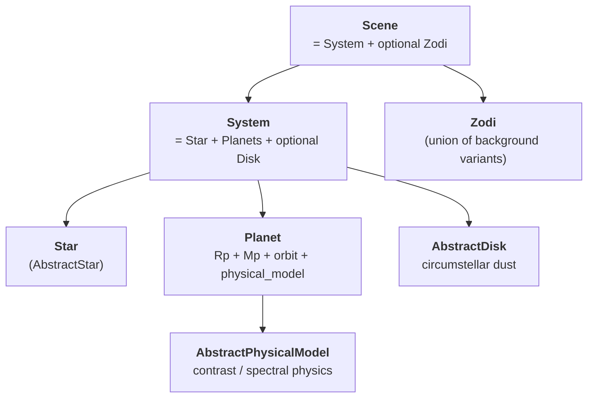

# Source models

skyscapes represents an astrophysical scene as a tree of `eqx.Module`
sources. This page covers what each source type is, how they compose,
and which variant to reach for in a given situation.

`Planet.propagate` returns orbix's star-centered (east, north, away)
positions unchanged. This frame is right-handed: z is positive away from
the observer, and dz/dt is positive receding. The standard phase angle
beta satisfies `cos(beta) = z / r` (zero at full phase).
`position_arcsec` reads rows 0 and 1 as (Delta alpha*, Delta Dec), where
Delta alpha* = Delta RA cos Dec. ExoVista positions and velocities are
converted from (west, north, toward) with `(-x, y, -z)` before deriving
elements; the header midplane mapping remains `(-PA) % 360`.

## The hierarchy



A complete `Scene` is:

```python
class Scene(eqx.Module):
    system: System              # required
    zodi: Zodi | None = None    # optional

class System(eqx.Module):
    star: AbstractStar
    planets: tuple[Planet, ...] = ()
    disk: AbstractDisk | None = None
    midplane_inc_deg: float = 0.0
    midplane_pa_deg: float = 0.0
    ...
```

Every level is an `eqx.Module`, which means: PyTree-registered for
JAX, fields are checked at construction, and `eqx.tree_at` works
end-to-end.

## Stars

Two concrete `AbstractStar` implementations:

| Class | When to use |
|---|---|
| `Star` | Tabulated stellar spectral flux, interpolated over wavelength and time with `interpax`. A single epoch is a static spectrum. ExoVista-loaded systems use this. |
| `FlatStar` | Simplification: constant flux independent of wavelength or time. Sandbox / testing / closed-form sanity checks. |

```python
import jax

jax.config.update("jax_enable_x64", True)

from skyscapes.scene import Star, FlatStar
import jax.numpy as jnp

# Realistic: wavelength + time dependence
star = Star(
    Ms_kg=1.989e30,
    dist_pc=10.0,
    wavelengths_nm=jnp.linspace(400, 1000, 60),
    times_jd=jnp.array([2_460_000.0, 2_460_730.5]),
    flux_density_jy=...,  # shape (n_wl, n_time)
)

# Sandbox: constant flux
flat = FlatStar(
    Ms_kg=1.989e30,
    dist_pc=10.0,
    flux_phot_per_nm_m2=1e9,
)

# Either implements the same interface
print(star.spec_flux_density(wavelength_nm=550.0, time_jd=2_460_365.0))
print(flat.spec_flux_density(wavelength_nm=550.0, time_jd=2_460_365.0))
```

`Star` is the canonical choice for any real target -- it ingests
ExoVista-style time- and wavelength-dependent flux tables. `FlatStar`
is the sandbox stand-in when you only need a single constant flux
value.

`flux_density_jy` is the observer's disk-integrated spectral flux
density, shape `(n_wl, n_time)`. `spec_flux_density` returns
photons/s/m^2/nm. Direct construction uses cubic interpolation by
default; stars imported with `from_exovista` use linear interpolation
(`interpolation_method="linear"`) to avoid overshooting nonnegative
samples. Multi-epoch tables return NaN outside their time range.
A single-epoch table is static at any
time, while the wavelength range remains bounded.

### Imported starspots and metadata

`Star.spots` is either `None` or a `StarSpots` object imported from the
optional ExoVista spot extension. It stores `times_jd` and geometry
arrays with shape `(n_times, n_spots)`:

| Field | Meaning |
|---|---|
| `latitude_deg`, `longitude_deg` | Recorded positions in the source's stellar coordinate convention |
| `area_m2` | Total spot area, including the umbra, converted from the FITS area units |
| `area_ratio` | Total spot area divided by umbra area |
| `umbra_temperature_k`, `penumbra_temperature_k` | Component temperatures from the stellar header, or `None` when absent |

`Star.metadata` retains the stellar FITS header values under uppercase
keys, excluding blank, `COMMENT`, and `HISTORY` cards. These records
preserve the source information, including the original west-based `PA`.
The system's disk orientation instead uses `System.midplane_inc_deg = I`
and `System.midplane_pa_deg = (-PA) % 360` in the east/north chart, for
parametric disks and visualization outlines. The metadata do not supply
spot evolution or an evaluator for spatially resolved stellar intensity. A downstream
diameter-only coronagraph response does not acquire asymmetric
starspot leakage merely by loading `Star.spots`. That calculation
requires a surface-brightness model and an optical response evaluated
across the stellar disk.

### ExoVista layouts and time conventions

Enable `jax_enable_x64` before calling `from_exovista`; the importer
requires it to preserve epoch and orbital-state precision and raises
`ValueError` when x64 is disabled. ExoVista stores elapsed simulation
years. The importer assigns simulation time zero to J2000.0 and
converts Julian years using
`time_jd = 2451545.0 + 365.25 * elapsed_years`. This assigned origin is
not a measured observation date, and the year values are not calendar
decimal years.

The importer locates the star and planets using their FITS headers.
It supports the legacy stellar extension and the newer layout with a
spot extension before the star, including ExoVista v2.6, without
relying on an extension-count header alone.

The stellar angular diameter is $2 R_\star / d$, computed from the
header's `RSTAR` (solar radii) and `DIST` (pc). ExoVista's `ANGDIAM`
card is not used for it, because its meaning depends on the input: a
scene built from a system file stores the angular radius there, while a
scene built from the target catalog stores the angular diameter and
derives `RSTAR` from it. Every ExoVista version this importer reads
records `RSTAR` and `DIST`; a stellar header without a finite `RSTAR` of at least zero and a
finite positive `DIST` is rejected rather than read from `ANGDIAM` at a
possibly halved size.

ExoVista documents the stellar spectral columns as observer flux
density in Jy, but the v2.5 and v2.6 writers store the PHOENIX emergent
surface flux density $F_\lambda$ in erg s$^{-1}$ cm$^{-2}$ cm$^{-1}$,
multiplied by the area of their limb-darkening mask (0.91091 of the
geometric disk for the solar coefficients they hard-code). A stellar
extension marked `SPECUNIT='Jy'` is read as Jy. A newer-layout file
without the marker is converted to the observer flux density

$$F_\nu = \frac{F_\lambda^{\rm stored}}{0.91091}
\left(\frac{R_\star}{d}\right)^2 \frac{\lambda^2}{c},$$

using the header's `RSTAR` and `DIST`, with no factor of $\pi$ because
PHOENIX tabulates flux rather than intensity. Both must be finite numbers,
or the import fails. When the header carries a numeric `VMAG` and a
channel lies within 60 nm of 550 nm, the converted spectrum there must lie
within a factor of three of that magnitude's flux, or the import fails
rather than guess the units. Without either, the spectrum is converted
with a warning that it could not be checked. Legacy-layout files are read
as Jy, and an explicitly different `SPECUNIT` is rejected.

The `planet_spectra` argument determines the planet contrast model:

| Mode | Behavior |
|---|---|
| `"auto"` (default) | Legacy layout uses `GridPhysicalModel`; newer layout uses `TimeSeriesPhysicalModel`. |
| `"time"` | Retains contrast at recorded physical epochs in either layout. |
| `"phase"` | Converts the record to a phase-only `GridPhysicalModel`, discarding time-dependent activity history. |

The time-series model returns NaN outside a multi-epoch record and
treats a single epoch as a constant snapshot. Its spectral queries
remain bounded by the wavelength grid. See
[physical models](physical_models) for the time-aware contrast API.

## Planets

`Planet` owns the planet's **intrinsic parameters** (`Rp_Rearth`,
`Mp_Mearth`) and composes two submodels: an orbit (from `orbix`) and
a physical model (from `skyscapes.physical_model`). The intrinsic
parameters live on `Planet` itself because they describe the planet,
not the submodel that happens to use them at evaluation time.

```python
import jax.numpy as jnp
from orbix.orbit import KeplerianOrbit

from skyscapes.scene import Planet
from skyscapes.physical_model import LambertianPhysicalModel

orbit = KeplerianOrbit(
    a_AU=jnp.array([1.0]),
    e=jnp.array([0.0]),
    W_rad=jnp.array([0.0]),
    i_rad=jnp.array([jnp.pi / 3]),
    w_rad=jnp.array([0.0]),
    M0_rad=jnp.array([jnp.pi / 4]),
    t0_d=jnp.array([0.0]),
)
physical_model = LambertianPhysicalModel(Ag=jnp.array([0.3]))
planet = Planet(
    Rp_Rearth=jnp.array([1.0]),
    Mp_Mearth=jnp.array([1.0]),
    orbit=orbit,
    physical_model=physical_model,
)
```

A single `Planet` instance carries `K` planets that share the same
orbit type and physical-model type -- every per-planet field
(``Rp_Rearth``, ``Mp_Mearth``, orbital elements, model parameters)
is an array of length `K`. This is the "per-Planet-type batching"
convention; heterogeneous planets (different physical-model classes)
go into `System.planets` as a tuple of `Planet` instances.

```python
# Two planets sharing a Lambertian physical model
two_planet = Planet(
    Rp_Rearth=jnp.array([1.0, 11.2]),
    Mp_Mearth=jnp.array([1.0, 317.0]),
    orbit=KeplerianOrbit(
        a_AU=jnp.array([1.0, 5.0]),
        e=jnp.array([0.0, 0.05]),
        # ... other elements as (K=2,) arrays
    ),
    physical_model=LambertianPhysicalModel(Ag=jnp.array([0.3, 0.5])),
)
```

## Disks

`AbstractDisk` has several concrete implementations under
`skyscapes.disk`:

| Class | What it is |
|---|---|
| `ExovistaDisk` | Disk loaded from an ExoVista FITS file; runtime-tabulated brightness map |
| `ExovistaParametricDisk` | Three-component Henyey-Greenstein fit to an ExoVista disk; differentiable surrogate |
| `GraterDisk` | Two-power-law density × Henyey-Greenstein scattering; parametric / synthetic |
| `CompositeDisk` | Sum of any other disks (e.g. main disk + a clump) |

Loaded disks (`ExovistaDisk`) capture real ExoVista physics but are
non-differentiable through the disk's morphology. Parametric disks
(`GraterDisk`, `ExovistaParametricDisk`) are fully differentiable --
you can take gradients of observables with respect to disk parameters.

`ExovistaDisk.contrast_cube` and `surface_brightness` use +column east
(Delta alpha* = Delta RA cos Dec) and +row north, matching planet sky
positions and parametric disk images. ExoVista writes +column west, so
`from_exovista` mirrors the columns at load. The pixel scale and geometric
image center are preserved.

```python
from skyscapes.disk import GraterDisk

disk = GraterDisk(
    sma_inner_au=2.0,
    sma_outer_au=10.0,
    alpha_in=2.0,
    alpha_out=-2.0,
    scale_height_au=0.1,
    flux_density_at_1au_jy_per_arcsec2=...,
    g_hg=0.3,
)
```

For retrievals on a real disk, fit `ExovistaParametricDisk` to the
ExoVista data once, then use the parametric form in the inference
loop.

## Zodi (backgrounds)

Backgrounds are anything in the field of view that is not part of the
planetary system itself. Currently zodiacal light is the only kind
modeled; the `skyscapes.background` submodule will grow to host
extragalactic background, scattered starlight, etc. as needed.

Three Zodi variants (each implements `spec_flux_density`):

| Class | What it is |
|---|---|
| `AYOZodi` | AYO-convention defaults: fixed V-band magnitude × Leinert wavelength-dependent colour correction. Position-independent (the AYO convention bakes in solar longitude 135 deg). |
| `LeinertZodi` | Full Leinert+1998 position-dependent model: surface brightness varies with ecliptic latitude and solar longitude. Use when telescope-orbit geometry matters. |
| `PrecomputedZodi` | Wraps an externally computed photon-flux array (e.g. from EXOSIMS) for fast lookup. Position arguments accepted but ignored. |

```python
from skyscapes.background import AYOZodi, LeinertZodi, PrecomputedZodi
import jax.numpy as jnp

# Sandbox / AYO-compatible
zodi = AYOZodi(
    wavelengths_nm=jnp.linspace(400, 1000, 60),
    surface_brightness_mag=22.0,
)

# Realistic position-dependent
zodi = LeinertZodi(reference_mag_arcsec2=22.0)

# Externally computed
zodi = PrecomputedZodi(
    wavelengths_nm=...,
    flux_phot_per_arcsec2=...,
    reference_mag_arcsec2=22.0,
)

scene = Scene(system=system, zodi=zodi)
```

The `Zodi` union type covers all three:

```python
from skyscapes.background import Zodi

def my_function(zodi: Zodi):
    # accepts any concrete Zodi variant
    ...
```

For the geometry inputs that `LeinertZodi.spec_flux_density` requires
(ecliptic latitude, solar longitude), see
[local zodi + telescope geometry](local_zodi_geometry).

## Physical models

Physical models (reflective, emissive, joint) are documented
separately -- see [physical models](physical_models).

## Composition

The same `Scene` is consumed by every downstream tool. Build it once,
use it everywhere:

```python
from skyscapes import Scene, System, from_exovista

# From ExoVista
import jax

jax.config.update("jax_enable_x64", True)
system = from_exovista("system.fits", planet_spectra="auto")
scene = Scene(system=system)

# Or programmatically
scene = Scene(
    system=System(star=star, planets=(planet,), disk=disk),
    zodi=zodi,
)

# Downstream usage
from coronagraphoto import system_readout
from jaxedith import compute_etc  # hypothetical API

image = system_readout(scene, optical_path, key, ...)
exposure_time_s = compute_etc(scene, optical_path, target_snr=7.0)
```

## See also

- [Physical models](physical_models) -- the physical-model hierarchy
- [Local zodi + telescope geometry](local_zodi_geometry) -- the
  Leinert geometry inputs
